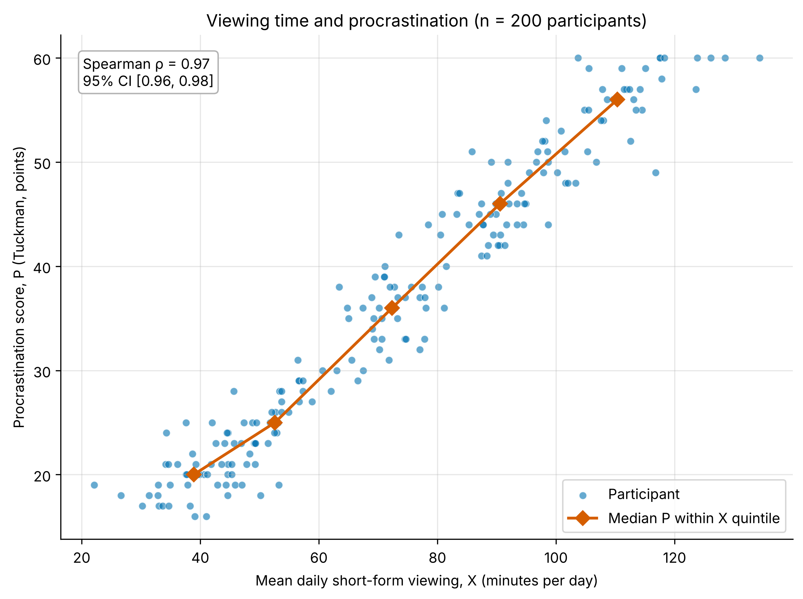
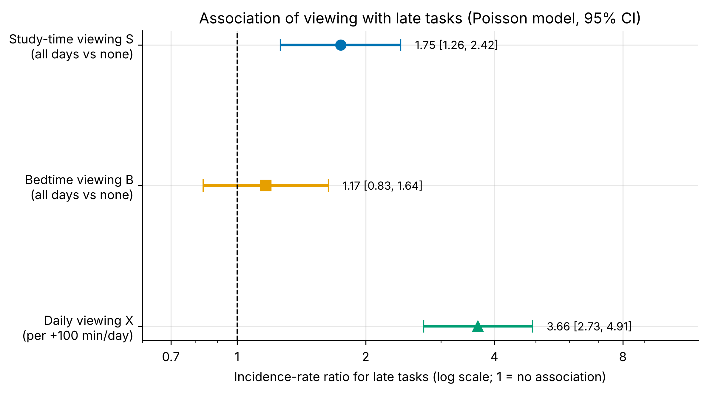
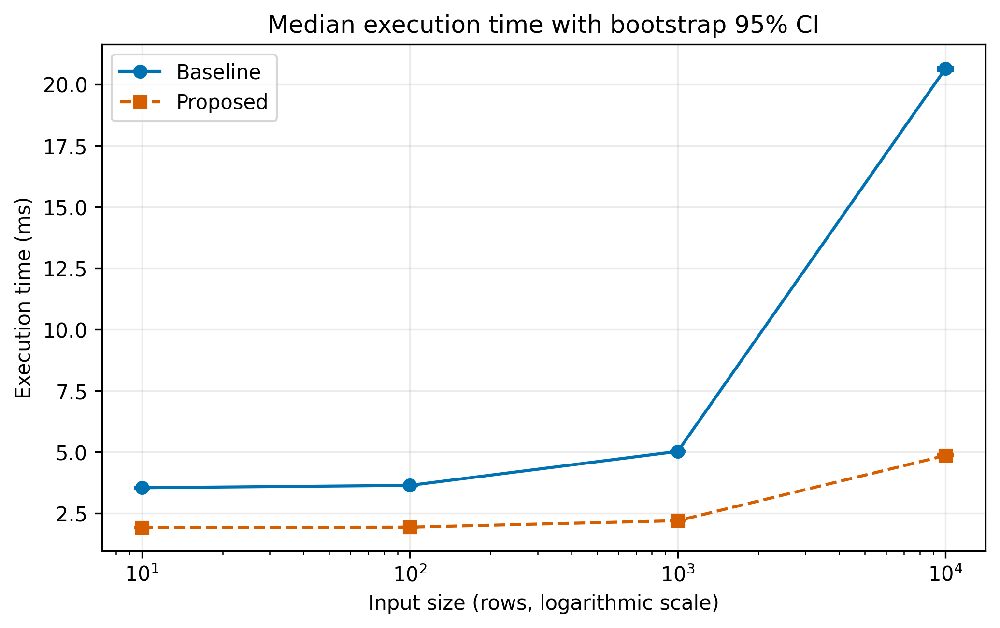
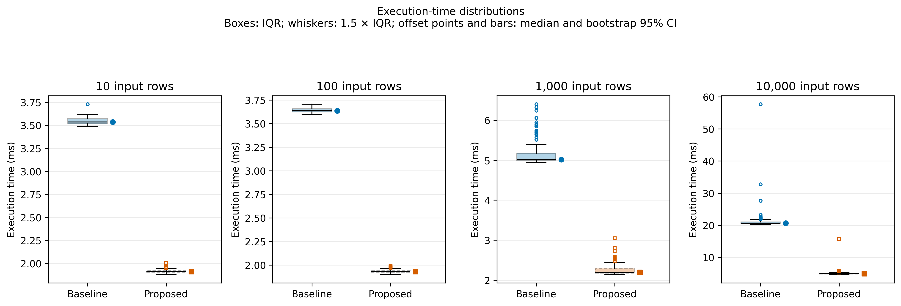

# The Impact of Short-Form Video Content on Student Procrastination and Academic Deadline Adherence

[](https://opensource.org/licenses/MIT)
[](https://www.python.org/downloads/release/python-3119/)
[](#)
[](#reproducibility)

**Authors:** Nuray Aben (nuraiaben-dev) & Akniet Abish (aknietabish-cpu)

**Course:** Research Methods — Task 2: Methodology Passport Card & Research Repository  

**Institution:** [Narxoz]  

**Date:** October–November 2026

---

## Overview & Research Aim

This repository contains the research protocol, methodology passport card, and reproducible analysis pipeline (including the analysis of the collected diary data) for an observational study examining whether short-form video consumption (TikTok, Instagram Reels, YouTube Shorts) is associated with increased procrastination and reduced academic deadline adherence among university students.

**Research Question(s):**

- **RQ1** (descriptive): What are students' average daily short-form video viewing time and baseline procrastination scores?
- **RQ2** (associational): Is daily viewing time positively associated with procrastination?
- **RQ3** (associational): Are viewing during academic tasks and viewing before bedtime associated with a higher proportion of missed academic deadlines?

**Core hypothesis (H1 for RQ2):** There is a positive association (Spearman ρ > 0) between daily short-form video viewing time and procrastination scores.

**Study Design:** Mixed-Methods — primary quantitative observational design (14-day diary + questionnaire + device screen-time evidence), with optional qualitative follow-up interviews.

**Two kinds of results live here.** (1) The analysis of the collected 14-day diary data
(200 students), reported in [Analysis of the collected data](#analysis-of-the-collected-data).
The design is observational, so the findings are associations, not causal effects.
(2) A synthetic-data benchmark of the aggregation code ([Week 7 Benchmark](#week-7-benchmark)
and [Task 3 Results](#task-3-results-and-discussion)), which evaluates software performance
only and says nothing about student behaviour.

---

## System Requirements & Prerequisites

**Hardware:**

- Any modern CPU (no GPU required — this is a behavioural study, not a deep-learning workload)
- ≥ 4 GB RAM (8 GB recommended)
- ≥ 500 MB free disk space

**Operating System:**

- macOS 12+, Ubuntu 20.04+, or Windows 10+ (via WSL2 or Anaconda Prompt)

**Software:**

- [Miniconda 23.x+](https://docs.conda.io/en/latest/miniconda.html) or [Anaconda 2023.x+](https://www.anaconda.com/)
- Python 3.11.9 (installed automatically via `environment.yml`)
- Git 2.30+
- Optional: [Docker Desktop 4.x+](https://www.docker.com/products/docker-desktop/) (see `Dockerfile`)

---

## Repository Structure

```
shortform-video-procrastination-study/
│
├── README.md
├── LICENSE
├── .gitignore
├── .dockerignore
├── environment.yml
├── Dockerfile
│
├── configs/
│   └── config.yaml
│
├── data/
│   ├── sample/
│   │   └── sample_data.csv            # synthetic, 10 rows
│   ├── raw/
│   │   ├── real_data.csv              # collected data (pseudonymised)
│   │   ├── test_run.jsonl             # benchmark logs (synthetic)
│   │   ├── test_run_metadata.json
│   │   ├── test_run_summary.json
│   │   ├── comparison_run.jsonl
│   │   └── comparison_run_metadata.json
│   └── processed/
│       ├── metrics_summary.csv        # benchmark statistics
│       ├── real_results_summary.csv   # aggregate results, collected data
│       └── real_participant_level.csv # one row per participant
│
├── docs/
│   ├── methodology.md
│   ├── domain_model.md
│   └── reproducibility_checklist.md
│
├── notebooks/
│   └── 01_data_analysis.ipynb         # analysis of the collected data
│
├── reports/
│   ├── figures/
│   │   ├── real_fig1_viewing_vs_procrastination.{png,pdf}
│   │   ├── real_fig2_irr_forest.{png,pdf}
│   │   ├── fig1_latency_vs_load.{png,pdf}        # benchmark
│   │   └── fig2_distribution_boxplot.{png,pdf}   # benchmark
│   ├── paper_section_4.md
│   └── task3_report.md                # benchmark report
│
└── src/
    ├── common.py                      # shared helpers (late-task derivation)
    ├── analyze.py                     # validation, X/S/B/P/L/A, RQ1-RQ3
    ├── aggregation.py                 # one-pass aggregation (benchmark)
    ├── benchmark.py
    ├── compare_benchmark.py
    ├── process_data.py                # benchmark statistics
    └── visualize.py                   # benchmark figures
```

---
## Quickstart & Reproducibility Guide

### Option A — Conda (Recommended)

Run the pipeline in a few commands (the collected data are in `data/raw/real_data.csv`):

```bash
# 1. Clone the repository and enter directory
git clone https://github.com/nuraiaben-dev/shortform-video-procrastination-study.git
cd shortform-video-procrastination-study

# 2. Create and activate environment
conda env create -f environment.yml
conda activate shortform-study
# 3. Analyse the collected data (RQ1-RQ3, guardrails) and save the tables
python src/analyze.py --config configs/config.yaml --input data/raw/real_data.csv --save

# 4. Or smoke-test the same pipeline on the synthetic sample (no real data needed)
python src/analyze.py --config configs/config.yaml --input data/sample/sample_data.csv --min-valid-days 1

# 5. Aggregation benchmark (synthetic sample only)
python src/benchmark.py --config configs/config.yaml
```

### Option B — Docker

```bash
# 1. Build the image
docker build -t shortform-study .

# 2. Run the pipeline inside the container
docker run --rm -v "$PWD":/work shortform-study \
    python src/analyze.py --config configs/config.yaml --input data/sample/sample_data.csv --min-valid-days 1
```

**Expected output:** the script prints the data-quality report, descriptive estimates, the Spearman ρ with a directional p-value, the incidence-rate-ratio model and the viewing-pattern groups, and writes a log file to `results/run.log`. With `--save` it also writes `data/processed/real_results_summary.csv` and `data/processed/real_participant_level.csv`.

---

## Expected Results / Benchmark Table

The table below summarises the metrics defined in the protocol. Estimated values for the collected data are in [Analysis of the collected data](#analysis-of-the-collected-data).

| Metric | Role | Formula / Definition | Collection Source | Expected Direction |
|---|---|---|---|---|
| Procrastination score **P** | Primary (RQ2 outcome) | Sum of 16-item Tuckman scale (reverse-coded) | Baseline questionnaire | — |
| Mean daily viewing **X** | Primary (RQ2 predictor) | Total valid viewing minutes / valid diary days | 14-day diary + device | — |
| Late-submission rate **R** | Primary (RQ3 outcome) | 100 × L / A, for A > 0 | Deadline log | — |
| Spearman **ρs** | Primary (RQ2 effect) | Rank correlation between X and P | Derived | ρs > 0 (H1) |
| Adjusted **IRR** | Primary (RQ3 effect) | exp(β) from Poisson/NegBinom with log(A) offset | Derived | IRR > 1 (H1) |
| Diary completeness | Guardrail | 100 × valid days / 14 (≥ 10 required) | Diary | ≥ 71% |
| Proxy discrepancy | Guardrail | Diary minutes vs. app minutes | Diary vs. device | Report only |
| On-time rate | Guardrail (secondary) | 100 × (A − L) / A | Deadline log | — |

**Baseline / Reference group:** Students reporting *neither* study-time viewing *nor* bedtime viewing (the "neither" pattern group). Continuous predictors X, S, B are the primary adjusted predictors.

---

## Methodology Passport Card

The full **Methodology Passport Card** (Task 2 submission document) is available at:

📄 [`docs/methodology.md`](docs/methodology.md)

It contains: research type, hypotheses H0/H1, variable matrix (independent / dependent / controlled), primary and guardrail metrics, and the baseline definition.

---

## Reproducibility

- Exact dependency versions are pinned in `environment.yml`.
- All experiment parameters live in `configs/config.yaml`.
- Random seeds for resampling are fixed in the config.
- The analysis script is deterministic given the same inputs.
- A reviewer-facing audit checklist is at [`docs/reproducibility_checklist.md`](docs/reproducibility_checklist.md).

---

## Data & Privacy

- The collected diary data (`data/raw/real_data.csv`, 200 participants, 14 days, one row per participant-day) are published in this repository so that the analysis can be reproduced. They were collected following the protocol in [`docs/methodology.md`](docs/methodology.md) (informed consent, random study IDs).
- The file contains only pseudonymised study IDs (`P001`…), age, gender and diary/questionnaire values. Names, contact information and the ID-to-person key are stored separately and never enter the repository.
- Please do not attempt to re-identify participants.
- A synthetic `data/sample/sample_data.csv` (10 rows) is included for pipeline testing and the aggregation benchmark.
- Derived outputs (`data/processed/real_participant_level.csv`, `data/processed/real_results_summary.csv`) and figures are produced by `src/analyze.py` and the notebook.

---

## Citation

If you reference this protocol, please cite:

```bibtex
@misc{akniet2026shortform,
  author       = {Akniet, Nuray},
  title        = {The Impact of Short-Form Video Content on Student Procrastination
                  and Academic Deadline Adherence: Research Protocol and Reproducible Pipeline},
  year         = {2026},
  publisher    = {GitHub},
  howpublished = {\url{https://github.com/nuraiaben-dev/shortform-video-procrastination-study}},
  note         = {Research protocol and analysis of diary data}
}
```

---

## License

This project is licensed under the **MIT License** — see the [LICENSE](LICENSE) file for details.

---

## References

1. Tuckman, B. W. (1991). The Development and Concurrent Validity of the Procrastination Scale. *Educational and Psychological Measurement*, 51(2), 473–480. https://doi.org/10.1177/0013164491512022
2. Microsoft Learn. Microsoft Threat Modeling Tool threats. https://learn.microsoft.com/azure/security/develop/threat-modeling-tool-threats
3. FIRST. CVSS v4.0 User Guide. https://www.first.org/cvss/user-guide.html

## Analysis of the collected data

**Data.** 200 students, 2,360 participant-days (10–14 valid diary days each; no participant or day was excluded). The unit of analysis is the **participant**: the procrastination score is measured once per student, so the 2,360 days are aggregated to one row per participant before any test, and bootstrap intervals resample participants.

| Question | Result (95% CI) |
|---|---|
| RQ1: mean daily viewing X | 73.1 (69.5–76.7) min/day |
| RQ1: mean Tuckman score P | 36.5 (34.7–38.3) points |
| RQ1: late-task rate | 23.9 (22.0–25.8) % |
| RQ2: Spearman ρ (X vs P), one-sided | 0.97 (0.96–0.98), p < 0.001 |
| RQ3a: IRR for study-time viewing S (Holm p < 0.001) | 1.75 (1.26–2.42) |
| RQ3b: IRR for bedtime viewing B (Holm p = 0.18) | 1.17 (0.83–1.64) |
| IRR per +100 min/day of viewing | 3.66 (2.73–4.91) |

Daily viewing and procrastination are strongly positively associated (H1 for RQ2 supported). Viewing during study time is associated with more late tasks; bedtime viewing is not clearly associated. The association is unusually strong, so the measurement of X and P should be discussed when reporting. The data are observational, so these are associations, not causal effects. Limitations (convenience sample, protocol covariates not collected, derivation of late tasks) are listed in the notebook.





**Reproduce:**

```bash
python src/analyze.py --config configs/config.yaml --input data/raw/real_data.csv --save
jupyter notebook notebooks/01_data_analysis.ipynb
```

Artifacts: [executed notebook](notebooks/01_data_analysis.ipynb), [aggregate results](data/processed/real_results_summary.csv), [domain model](docs/domain_model.md), [methodology](docs/methodology.md).

## Week 7 Benchmark

The benchmark measures the execution time of
`derive_participant_level` on the 10-row synthetic sample.
CSV reading, file writing and console output are outside
the timed section.

### Run

With the project environment installed:

```bash
conda activate shortform-study
python src/benchmark.py --config configs/config.yaml
```

Settings are stored in `configs/config.yaml`.

### Test results

10 warm-up runs were excluded from summary statistics.
All 100 measured runs completed successfully.

| Metric | Value |
|---|---:|
| Successful runs | 100 |
| Failed runs | 0 |
| Mean | 3.520 ms |
| Median | 3.516 ms |
| p95 | 3.552 ms |
| p99 | 3.566 ms |

These timings describe one local test on synthetic data.
They are not findings about student behaviour.
Timings may differ across machines and runs.

### Output files

- `data/raw/test_run.jsonl`: individual measurements,
  labelled as warm-up or measurement.
- `data/raw/test_run_metadata.json`: environment and configuration.
- `data/raw/test_run_summary.json`: summary statistics.

Only synthetic benchmark outputs are committed.
Benchmark outputs use the synthetic sample only.

## Task 3 Results and Discussion

*Performance benchmark of the aggregation step. All data in this section are synthetic.*

### Experimental setup

We compared two implementations of participant-level diary aggregation:

- **Baseline:** separate grouped aggregations followed by table merges.
- **Proposed:** one grouped aggregation producing the same variables.

Both methods were tested on 10, 100, 1,000 and 10,000 synthetic rows.
Outputs matched for every workload before timing.

Each method completed 10 warm-up and 100 measured runs per workload.
Warm-up runs were excluded from final statistics. Method order was
randomized within paired repetitions. All 800 measured runs succeeded.

### Results

The table below shows rounded median execution times.
The executed notebook and CSV also report quartiles, mean, sample SD,
p95, p99 and bootstrap 95% confidence intervals.

| Input size (rows) | Baseline median (p25–p75), ms | Proposed median (p25–p75), ms | Speedup |
|---:|---:|---:|---:|
| 10 | 3.537 (3.517–3.571) | 1.910 (1.903–1.920) | 1.85× |
| 100 | 3.635 (3.622–3.658) | 1.929 (1.921–1.938) | 1.88× |
| 1,000 | 5.016 (4.991–5.171) | 2.193 (2.176–2.291) | 2.29× |
| 10,000 | 20.647 (20.481–21.025) | 4.852 (4.797–4.975) | 4.26× |

Speedup is the baseline median divided by the proposed median.

The proposed method had lower median execution time at every tested
input size. Its relative advantage was largest at 10,000 rows.
Both methods had an observed error rate of 0% in this experiment.

### Scientific figures





Vector exports:
[Figure 1 PDF](reports/figures/fig1_latency_vs_load.pdf) |
[Figure 2 PDF](reports/figures/fig2_distribution_boxplot.pdf)

### Reproduce the analysis

After installing and activating the project environment:

```bash
python src/process_data.py
python src/visualize.py
```

To collect a new comparison log:

```bash
python src/compare_benchmark.py --config configs/config.yaml
```

This command overwrites the comparison log. Re-run processing and
visualization afterwards; numerical results may differ.

### Domain model

See the [study domain model, analysis pipeline and benchmark measurement boundaries](docs/domain_model.md).
### Limitations

The benchmark used one computer and repeated synthetic sample data.
Increasing workload size increased both row count and participant-group
count. Their effects were not isolated.

Bootstrap intervals use 5,000 resamples with seed 42 and describe
within-session uncertainty under an independent-run assumption.
They do not capture differences across machines or separate sessions.
With 100 measurements per group, p99 estimates are approximate.

These benchmark results evaluate software performance. The behavioural hypotheses
are tested in [Analysis of the collected data](#analysis-of-the-collected-data).

### Analysis artifacts

- [Full statistical summary](data/processed/metrics_summary.csv)
- [Comparison measurements](data/raw/comparison_run.jsonl)
- [Experiment metadata](data/raw/comparison_run_metadata.json)
