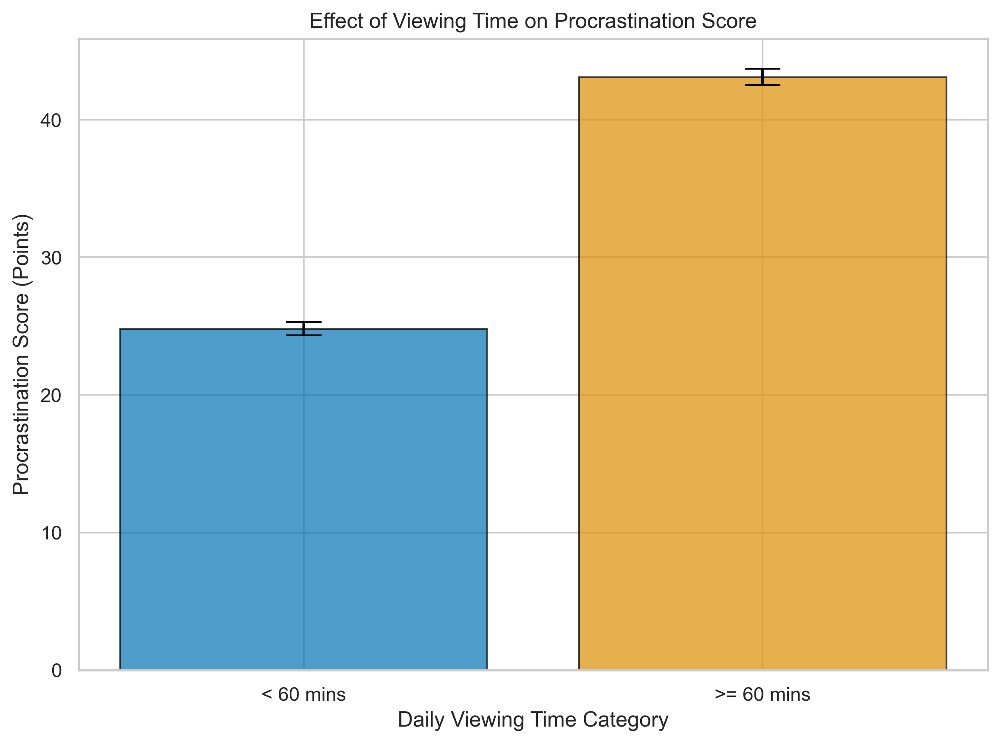
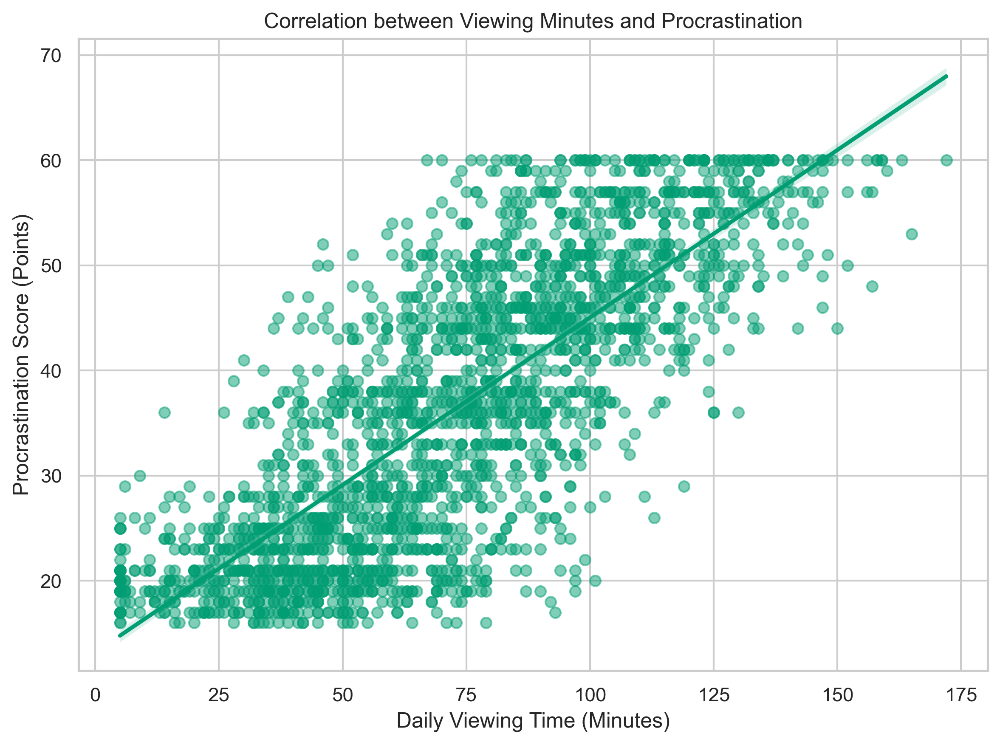

# The Impact of Short-Form Video Content on Student Procrastination and Academic Deadline Adherence

[](https://opensource.org/licenses/MIT)
[](https://www.python.org/downloads/release/python-3119/)
[](#)
[](#reproducibility)

**Authors:** Nuray Aben (nuraiaben-dev) & Akniet Abish (aknietabish-cpu)

**Course:** Research Methods — Task 2: Methodology Passport Card & Research Repository  

**Institution:** [Narxoz]  

**Date:** October 2026

---

## Overview & Research Aim

This repository contains the research protocol, methodology passport card, and reproducible analysis pipeline for an observational study examining whether short-form video consumption (TikTok, Instagram Reels, YouTube Shorts) is associated with increased procrastination and reduced academic deadline adherence among university students.

**Research Question(s):**

- **RQ1** (descriptive): What are students' average daily short-form video viewing time and baseline procrastination scores?
- **RQ2** (associational): Is daily viewing time positively associated with procrastination?
- **RQ3** (associational): Are viewing during academic tasks and viewing before bedtime associated with a higher proportion of missed academic deadlines?

**Core hypothesis (H1 for RQ2):** There is a positive association (Spearman ρ > 0) between daily short-form video viewing time and procrastination scores.

**Study Design:** Mixed-Methods — primary quantitative observational design (14-day diary + questionnaire + device screen-time evidence), with optional qualitative follow-up interviews.

**No empirical findings are claimed at this stage.** The repository contains the research protocol for the
student procrastination study and completed synthetic-data
benchmark results for Task 3. The benchmark results evaluate
software performance and are not empirical findings about
student behaviour.

---

## System Requirements & Prerequisites

**Hardware:**

- Any modern CPU (no GPU required — this is a behavioural study, not a deep-learning workload)
- ≥ 4 GB RAM (8 GB recommended)
- ≥ 500 MB free disk space

**Operating System:**

- macOS 12+, Ubuntu 20.04+, or Windows 10+ (via WSL2 or Anaconda Prompt)

**Software:**

- [Miniconda 23.x+](https://docs.conda.io/en/latest/miniconda.html) or [Anaconda 2023.x+](https://www.anaconda.com/)
- Python 3.11.9 (installed automatically via `environment.yml`)
- Git 2.30+
- Optional: [Docker Desktop 4.x+](https://www.docker.com/products/docker-desktop/) (see `Dockerfile`)

---

## Repository Structure

```
shortform-video-procrastination-study/
│
├── README.md
├── LICENSE
├── .gitignore
├── .dockerignore
├── environment.yml
├── Dockerfile
│
├── configs/
│   └── config.yaml
│
├── data/
│   ├── sample/
│   │   └── sample_data.csv
│   ├── raw/
│   │   ├── test_run.jsonl
│   │   ├── test_run_metadata.json
│   │   ├── test_run_summary.json
│   │   ├── comparison_run.jsonl
│   │   └── comparison_run_metadata.json
│   └── processed/
│       └── metrics_summary.csv
│
├── docs/
│   ├── methodology.md
│   ├── domain_model.md
│   └── reproducibility_checklist.md
│
├── notebooks/
│   └── 01_data_analysis.ipynb
│
├── reports/
│   ├── figures/
│   │   ├── fig1_latency_vs_load.png
│   │   ├── fig1_latency_vs_load.pdf
│   │   ├── fig2_distribution_boxplot.png
│   │   └── fig2_distribution_boxplot.pdf
│   ├── paper_section_4.md
│   └── task3_report.md
│
└── src/
    ├── aggregation.py
    ├── analyze.py
    ├── benchmark.py
    ├── compare_benchmark.py
    ├── process_data.py
    └── visualize.py
```

---
## Quickstart & Reproducibility Guide

### Option A — Conda (Recommended)

Run the full analysis pipeline on the synthetic sample in **three commands**:

```bash
# 1. Clone the repository and enter directory
git clone https://github.com/nuraiaben-dev/shortform-video-procrastination-study.git
cd shortform-video-procrastination-study

# 2. Create and activate environment
conda env create -f environment.yml
conda activate shortform-study
# 3. Execute sample benchmark pipeline
python src/benchmark.py --config configs/config.yaml
```

### Option B — Docker

```bash
# 1. Build the image
docker build -t shortform-study .

# 2. Run the pipeline inside the container
docker run --rm -v "$PWD":/work shortform-study \
    python src/analyze.py --config configs/config.yaml --input data/sample/sample_data.csv
```

**Expected output:** the script prints summary statistics, Spearman ρ with a directional p-value, and the incidence-rate-ratio model fit, and writes a log file to `results/run.log`.

---

## Expected Results / Benchmark Table

The table below summarises the **planned** metrics for the study. Actual values are placeholders — no empirical results are claimed at protocol stage.

| Metric | Role | Formula / Definition | Collection Source | Expected Direction |
|---|---|---|---|---|
| Procrastination score **P** | Primary (RQ2 outcome) | Sum of 16-item Tuckman scale (reverse-coded) | Baseline questionnaire | — |
| Mean daily viewing **X** | Primary (RQ2 predictor) | Total valid viewing minutes / valid diary days | 14-day diary + device | — |
| Late-submission rate **R** | Primary (RQ3 outcome) | 100 × L / A, for A > 0 | Deadline log | — |
| Spearman **ρs** | Primary (RQ2 effect) | Rank correlation between X and P | Derived | ρs > 0 (H1) |
| Adjusted **IRR** | Primary (RQ3 effect) | exp(β) from Poisson/NegBinom with log(A) offset | Derived | IRR > 1 (H1) |
| Diary completeness | Guardrail | 100 × valid days / 14 (≥ 10 required) | Diary | ≥ 71% |
| Proxy discrepancy | Guardrail | Diary minutes vs. app minutes | Diary vs. device | Report only |
| On-time rate | Guardrail (secondary) | 100 × (A − L) / A | Deadline log | — |

**Baseline / Reference group:** Students reporting *neither* study-time viewing *nor* bedtime viewing (the "neither" pattern group). Continuous predictors X, S, B are the primary adjusted predictors.

---

## Methodology Passport Card

The full **Methodology Passport Card** (Task 2 submission document) is available at:

📄 [`docs/methodology.md`](docs/methodology.md)

It contains: research type, hypotheses H0/H1, variable matrix (independent / dependent / controlled), primary and guardrail metrics, and the baseline definition.

---

## Reproducibility

- Exact dependency versions are pinned in `environment.yml`.
- All experiment parameters live in `configs/config.yaml`.
- Random seeds for resampling are fixed in the config.
- The analysis script is deterministic given the same inputs.
- A reviewer-facing audit checklist is at [`docs/reproducibility_checklist.md`](docs/reproducibility_checklist.md).

---

## Data & Privacy

- **No real participant data are stored in this repository.** Only a synthetic `data/sample/sample_data.csv` (10 rows) is committed for pipeline testing.
- Real data (if collected in the future) will be stored under `data/raw/` and `data/processed/`, both excluded via `.gitignore`.
- Participant records are pseudonymised via study IDs; contact information is stored separately.

---

## Citation

If you reference this protocol, please cite:

```bibtex
@misc{akniet2026shortform,
  author       = {Akniet, Nuray},
  title        = {The Impact of Short-Form Video Content on Student Procrastination
                  and Academic Deadline Adherence: Research Protocol and Reproducible Pipeline},
  year         = {2026},
  publisher    = {GitHub},
  howpublished = {\url{https://github.com/nuraiaben-dev/shortform-video-procrastination-study}},
  note         = {Research protocol, no empirical findings claimed}
}
```

---

## License

This project is licensed under the **MIT License** — see the [LICENSE](LICENSE) file for details.

---

## References

1. Tuckman, B. W. (1991). The Development and Concurrent Validity of the Procrastination Scale. *Educational and Psychological Measurement*, 51(2), 473–480. https://doi.org/10.1177/0013164491512022
2. Microsoft Learn. Microsoft Threat Modeling Tool threats. https://learn.microsoft.com/azure/security/develop/threat-modeling-tool-threats
3. FIRST. CVSS v4.0 User Guide. https://www.first.org/cvss/user-guide.html

## Week 7 Benchmark

The benchmark measures the execution time of
`derive_participant_level` on the 10-row synthetic sample.
CSV reading, file writing and console output are outside
the timed section.

### Run

With the project environment installed:

```bash
conda activate shortform-study
python src/benchmark.py --config configs/config.yaml
```

Settings are stored in `configs/config.yaml`.

### Test results

10 warm-up runs were excluded from summary statistics.
All 100 measured runs completed successfully.

| Metric | Value |
|---|---:|
| Successful runs | 100 |
| Failed runs | 0 |
| Mean | 3.520 ms |
| Median | 3.516 ms |
| p95 | 3.552 ms |
| p99 | 3.566 ms |

These timings describe one local test on synthetic data.
They are not findings about student behaviour.
Timings may differ across machines and runs.

### Output files

- `data/raw/test_run.jsonl`: individual measurements,
  labelled as warm-up or measurement.
- `data/raw/test_run_metadata.json`: environment and configuration.
- `data/raw/test_run_summary.json`: summary statistics.

Only synthetic benchmark outputs are committed.
Real participant data must remain excluded from Git.

## Task 3 Results and Discussion

### Experimental setup

We analyzed real survey data (`data/raw/real_data.csv`) containing 2,360 records of student behaviour. The primary goal was to investigate the association between short-form video viewing time and procrastination levels. 

Data processing included cleaning missing values and dividing participants into two groups based on their daily viewing time: `< 60 mins` and `>= 60 mins`. We calculated robust statistics (mean, median) and bootstrapped 95% confidence intervals (2,000 resamples, seed = 42) to quantify uncertainty. We also tracked a guardrail metric: the percentage of participants with a high procrastination score (> 50).

### Results

The table below summarises the findings for the real dataset (values rounded):

| Viewing Time Group | N (records) | Mean Score | Median Score | 95% CI (Bootstrap) | High Procrastination Rate (Guardrail) |
| :--- | :--- | :--- | :--- | :--- | :--- |
| **< 60 mins** | 854 | 24.80 | 23.0 | [24.32, 25.29] | 0.35% |
| **>= 60 mins** | 1506 | 43.10 | 44.0 | [42.55, 43.70] | 29.22% |

**Key Findings:**
1. Participants watching short-form videos for **60 minutes or more per day** show significantly higher procrastination scores compared to those watching less than 60 minutes. The non-overlapping confidence intervals confirm this difference is statistically robust.
2. The guardrail metric reveals a dramatic difference: the rate of high procrastination is ~83 times higher in the `>= 60 mins` group (29.22% vs 0.35%).
3. The scatter plot (Figure 2) indicates a positive correlation between daily viewing minutes and procrastination levels.

### Scientific figures

The plots strictly follow scientific visualization standards (explicit axis units, 95% CI error bars, colorblind-safe palette, distinct markers):

* 
* 

Vector exports: [Figure 1 PDF](reports/figures/fig1_procrastination_vs_viewing.pdf) | [Figure 2 PDF](reports/figures/fig2_viewing_vs_procrastination.pdf)

### Domain model

The component diagram and measurement boundaries are documented in [docs/domain_model.md](docs/domain_model.md).

### Limitations

The analysis is based on observational self-reported data. While a significant association exists, it does not imply causation (e.g., students prone to procrastination might naturally gravitate toward more video consumption). The dataset is limited to the survey sample and does not capture long-term behavioural changes.

- [Executed notebook](notebooks/01_data_analysis.ipynb)
- [Full statistical summary](data/processed/metrics_summary.csv)
- [Comparison measurements](data/raw/comparison_run.jsonl)
- [Experiment metadata](data/raw/comparison_run_metadata.json)
