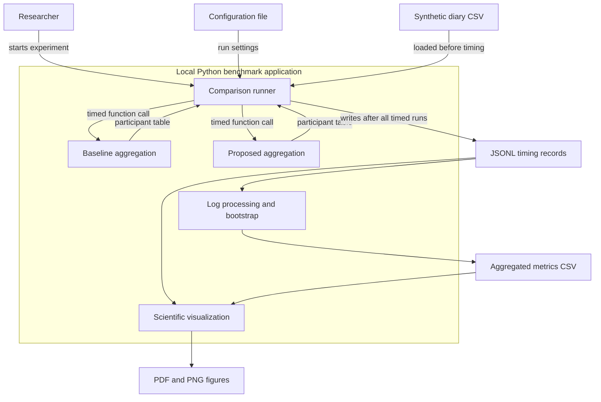

# Domain Model

## Scope

This C4-style component view describes the local Python benchmark
application used to compare two implementations of diary aggregation.
The components are Python modules within one application, rather
than separate deployed services.

## Components and measurement points

## Component responsibilities

| Component | Implementation | Responsibility |
|---|---|---|
| Comparison runner | `src/compare_benchmark.py` | Generate workloads, verify output equivalence, randomize execution order, separate warm-up and measured runs |
| Baseline aggregation | `src/analyze.py` | Derive participant-level variables through separate aggregations and merges |
| Proposed aggregation | `src/aggregation.py` | Derive the same variables using one grouped aggregation |
| Statistical processing | `src/process_data.py` | Exclude warm-up, retain failure counts, calculate descriptive statistics and bootstrap confidence intervals |
| Visualization | `src/visualize.py` | Generate figures with uncertainty indicators and export PDF and PNG |
| Analysis notebook | `notebooks/01_data_analysis.ipynb` | Reproduce processing, display tables and figures, and explain findings |

## Measurement boundary

The runner uses `time.perf_counter_ns()` immediately before and
after each aggregation function call. Execution time is converted
to milliseconds.

CSV reading, workload generation, equivalence checks, output
validation, console messages and log writing are outside the
timed section. Both implementations receive the same input for
each workload.

Each method has 10 warm-up and 100 measured runs per input size.
Warm-up records are labelled and excluded from final statistics.
Method order is randomized within each paired repetition.

## Data and interpretation

The workloads contain 10, 100, 1,000 and 10,000 synthetic diary rows.
Larger workloads repeat the sample with unique participant IDs.
They increase both row count and participant-group count.

The outputs are timing measurements, error rates, summary tables
and scientific plots. They describe software performance, not
empirical findings about students.

## Deployment and limitations

The experiment runs locally on one computer using the project
Python environment. It makes no external API requests.

Recording environment metadata supports reproducibility but does
not eliminate background OS activity or guarantee identical timings
on another machine.
