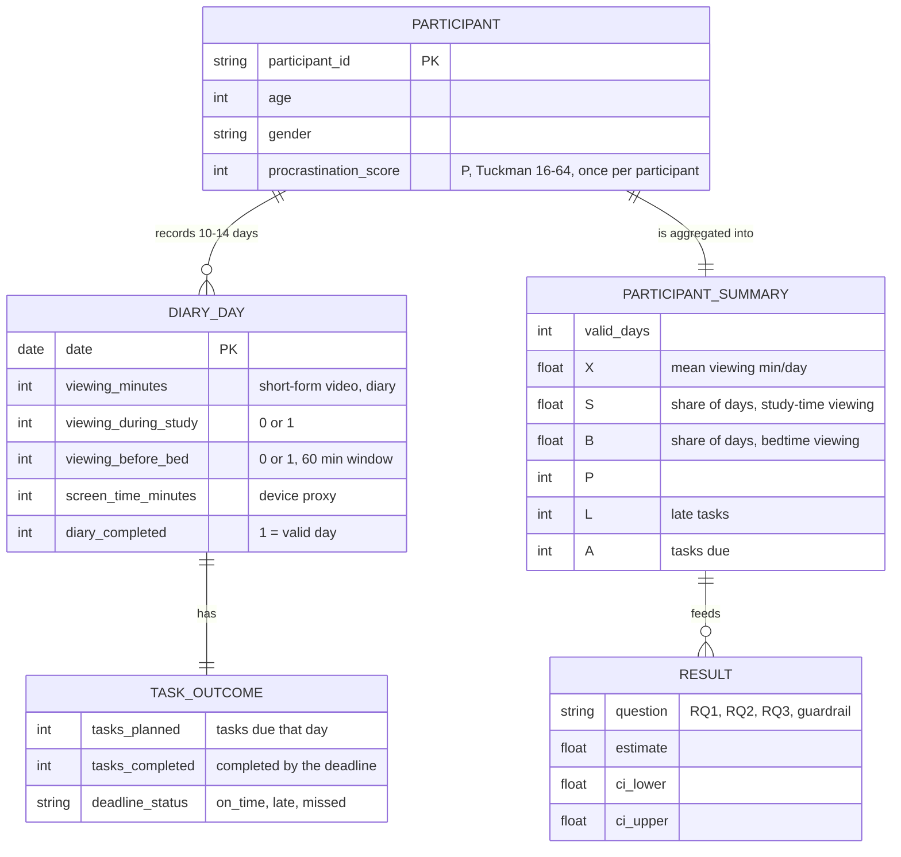
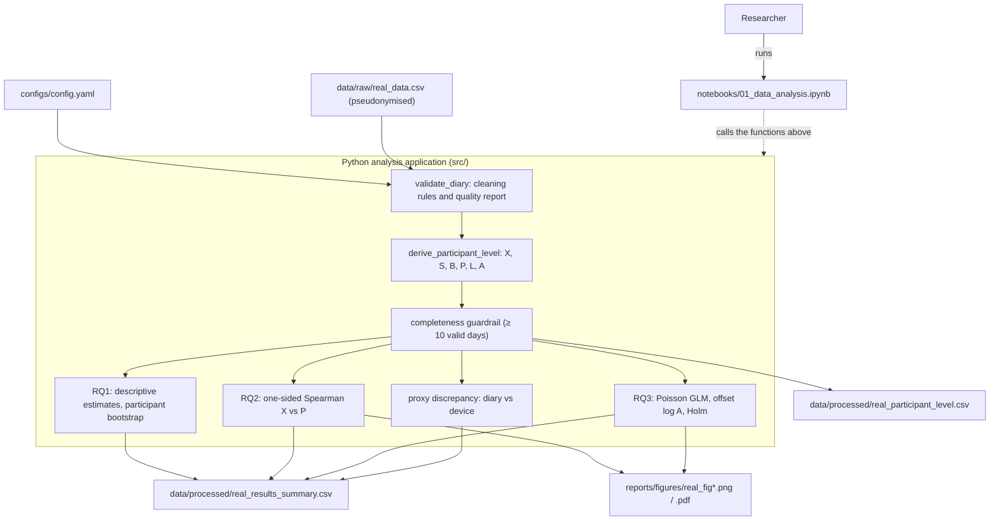
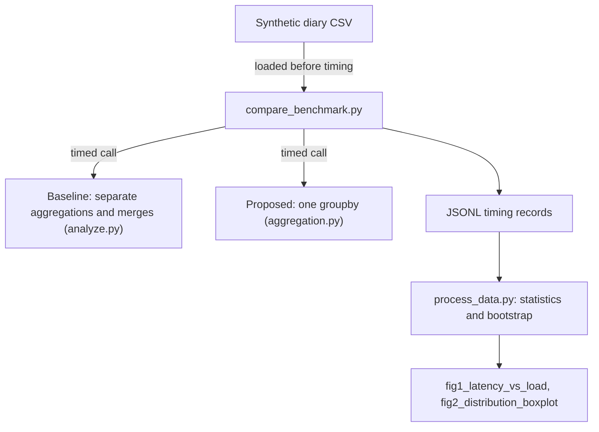

# Domain Model

This document has three parts: the **study domain** (what is measured and
how the entities relate), the **analysis pipeline** (which components turn
the diary data into results) and the **performance benchmark** of the
aggregation step, which is a separate synthetic-data experiment.

## 1. Study domain

### Entities

* **Participant** is the unit of analysis. The procrastination score *P*
  is one value per participant, so it cannot be treated as repeated
  measurements.
* **Diary day** and **task outcome** are the raw records (one row per
  participant-day in `real_data.csv`). Rows within one participant are
  not independent observations.
* **Participant summary** is the analysis table: one row per participant.
  All inference (Spearman, Poisson model, bootstrap) uses this table, and
  the bootstrap resamples participants.

### Derived variables

| Variable | Definition | Source columns |
|---|---|---|
| X | Σ viewing_minutes / valid_days | viewing_minutes |
| S | Σ viewing_during_study / valid_days | viewing_during_study |
| B | Σ viewing_before_bed / valid_days | viewing_before_bed |
| P | Tuckman score (constant per participant) | procrastination_score |
| A | Σ tasks_planned (tasks due) | tasks_planned |
| L | Σ max(tasks_planned − tasks_completed, 0); late and missed tasks both count | tasks_planned, tasks_completed |
| R | 100 × ΣL / ΣA (pooled late-task rate) | derived |

`deadline_status` is used for consistency checks only: `on_time` days
must have every task completed, `missed` days none.

### Business rules

1. A diary day is valid when `diary_completed = 1`, the values are present
   and non-negative, no more tasks are completed than planned, and the
   participant-date pair is unique.
2. A participant enters the exposure analysis with at least 10 valid
   days out of 14 (completeness guardrail).
3. H1 is directional: Spearman ρ > 0 (RQ2) and IRR > 1 for S and B (RQ3),
   with Holm correction across S and B.
4. Device screen time is a corroborating proxy. It is compared with the
   diary but never used to exclude participants.

## 2. Analysis pipeline

### Component responsibilities

| Component | Implementation | Responsibility |
|---|---|---|
| Validation | `analyze.validate_diary` | Apply cleaning rules, report removed rows and consistency checks |
| Derivation | `analyze.derive_participant_level`, `common.add_late_tasks` | One row per participant with X, S, B, P, L, A |
| Statistics | `analyze.run_rq1`, `run_rq2`, `run_rq3`, `proxy_discrepancy` | Estimates, bootstrap CIs, Spearman test, Poisson model with robust SEs, Holm correction |
| Entry point | `src/analyze.py` | Command-line run of the whole pipeline, log in `results/run.log` |
| Notebook | `notebooks/01_data_analysis.ipynb` | Executes the pipeline step by step, draws the figures, states conclusions |
| Configuration | `configs/config.yaml` | Column names, thresholds, seed, bootstrap size, output paths |

## 3. Performance benchmark (synthetic data only)

A separate experiment compares two implementations of the participant-level
aggregation in step 2. It uses the synthetic sample
`data/sample/sample_data.csv`, not the collected data, and describes software
performance only, not student behaviour.

The runner uses `time.perf_counter_ns()` immediately before and after each
aggregation call. CSV reading, workload generation, equivalence checks and
log writing are outside the timed section. Each method has 10 warm-up and 100
measured runs per input size (10, 100, 1,000, 10,000 rows), with random
method order. The committed timing logs in `data/raw/` were recorded before the
`late_tasks` derivation was added to both aggregation functions, so re-running
the benchmark may give slightly different timings.

Both implementations still return identical tables (checked on the sample and
on the collected data). The benchmark and the analysis share the same
`derive_participant_level` code path, which is why the benchmark stays in the repository.
