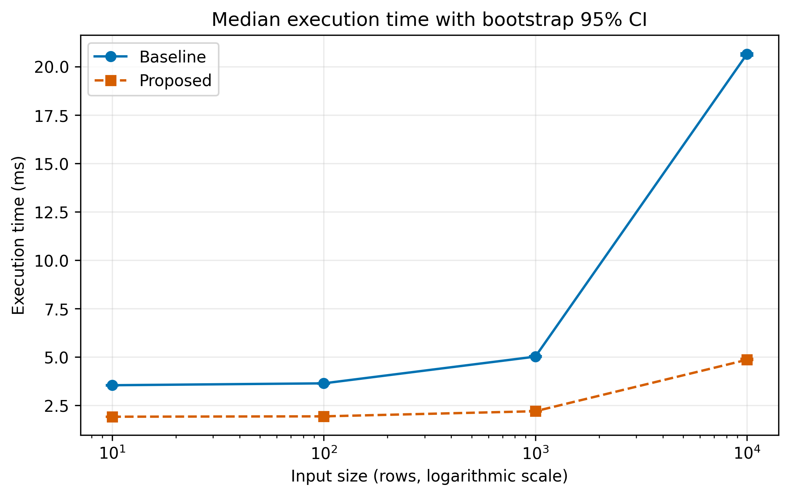
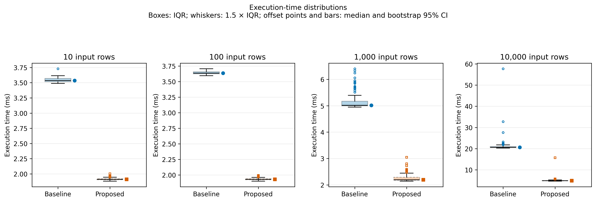

## 4. Experimental Results & Discussion

### 4.1 Formal Definitions of Metrics

All timing measurements are reported in milliseconds (ms). For each experimental condition, we collect $n = 100$ measured runs after discarding $n_{warmup} = 10$ warm-up runs. Let $x_1, \dots, x_n$ denote the execution times of the measured runs. The formal definition of the median and aggregated metrics (percentiles, confidence intervals, and speedup) are provided in the equations below.

**Median execution time.** The median is the 50th percentile of the measured execution times:

$$
median(x) =
\begin{cases}
x_{((n+1)/2)}, & n \text{ odd} \\
(x_{(n/2)} + x_{((n/2)+1)}) / 2, & n \text{ even}
\end{cases}
$$

where $x_{(1)} \le x_{(2)} \le \dots \le x_{(n)}$ is the ordered sample.

**Percentile.** The k-th percentile is defined as:

$$
p_k = x_{(\lceil k \cdot n / 100 \rceil)}
$$

**Bootstrap 95% confidence interval for the median.** We draw $B = 5000$ bootstrap resamples with replacement from the sample using a fixed random seed (seed = 42) to ensure reproducibility. For each resample we compute the bootstrap median. The 95% confidence interval is:

$$
CI_{95} = [ \theta_{0.025},\ \theta_{0.975} ]
$$

**Speedup ratio.** The speedup of the proposed method over the baseline is defined as the ratio of their median execution times:

$$
S = \frac{median(x_{baseline})}{median(x_{proposed})}
$$

A value $S > 1$ indicates that the proposed method is faster than the baseline; e.g., $S = 4.26$ means the proposed method is 4.26 times faster.

### 4.2 Notation Table

Table 1 summarizes the symbols used in the formal definitions above.

| Symbol | Description | Type |
|---|---|---|
| $n$ | Number of measured runs per condition | scalar (integer) |
| $n_{warmup}$ | Number of discarded warm-up runs | scalar (integer) |
| $x_i$ | Execution time of the i-th measured run (ms) | scalar |
| $x_{(i)}$ | i-th order statistic of the sample | scalar |
| $k$ | Percentile level (25, 75, 95, 99) | scalar |
| $p_k$ | k-th percentile of execution time (ms) | scalar |
| $B$ | Number of bootstrap resamples | scalar (integer) |
| $CI_{95}$ | Bootstrap 95% confidence interval for the median | interval |
| $S$ | Speedup ratio (baseline / proposed) | scalar (dimensionless) |

### 4.3 Baseline vs. Proposed: Execution-Time Comparison

**Table 1.** Median execution time (ms) with interquartile range (p25–p75) and speedup for baseline and proposed aggregation methods across four input sizes. Best median per row in **bold**.

| Input rows | Baseline median (ms) | Proposed median (ms) | Speedup $S$ |
|---:|---:|---:|---:|
| 10 | 3.537 (3.517–3.571) | **1.910** (1.903–1.920) | 1.85× |
| 100 | 3.635 (3.622–3.658) | **1.929** (1.921–1.938) | 1.88× |
| 1,000 | 5.016 (4.992–5.171) | **2.193** (2.176–2.291) | 2.29× |
| 10,000 | 20.647 (20.481–21.025) | **4.852** (4.797–4.975) | **4.26×** |

*Note.* Speedup is defined as $S = median(x_{baseline}) / median(x_{proposed})$. A value $S > 1$ indicates that the proposed method is faster. Both methods produced matching outputs on every tested workload; all 800 measured runs completed without errors (error rate = 0%).

### 4.4 Visual Comparison

The quantitative results from [Table 1](#table1) are visualized in the figures below. Figure 1 shows the median execution time as a function of input size. Figure 2 shows the full execution-time distributions for each method.

**Figure 1.** Median execution time (ms) versus input size (logarithmic scale) for the baseline and proposed aggregation methods. Vertical bars represent bootstrap 95% confidence intervals for the median ($B = 5000$ resamples, seed = 42). The proposed method has a lower median at every tested input size; the gap widens with input size, reaching a 4.26× speedup at 10,000 rows. The shaded bars indicate that the median is estimated precisely within each session, but they do not capture variation across machines or sessions.

**Figure 2.** Distribution of execution time (ms) for the baseline and proposed methods across four input sizes. Each box represents the interquartile range (p25–p75); whiskers extend to the most extreme observations within 1.5×IQR of the box; points beyond the whiskers are retained as outliers. Offset markers and bars show medians and their bootstrap 95% confidence intervals. Each panel uses its own vertical scale to accommodate the growth in execution time with input size. The baseline exhibits a longer upper tail at 10,000 rows (p99 ≈ 33 ms), whereas the proposed method remains tightly concentrated (p99 ≈ 5.9 ms).

### 4.5 Discussion and Limitations

As shown in [Table 1](#table1), the proposed aggregation method consistently outperforms the baseline in terms of execution time. At 10,000 rows, the median execution time drops from 20.647 ms to 4.852 ms, corresponding to a 4.26× speedup. Furthermore, [Figure 2](#figure2) demonstrates that the proposed method is more stable: the baseline's 99th percentile reaches approximately 33 ms due to outliers, whereas the proposed method remains below 6 ms.

However, these results concern computational performance on synthetic data in a single session on one machine. They do not establish a behavioral association between short-form video use and student procrastination. The pipeline is simply validated as a fast and reproducible tool for future analysis of real participant data.
